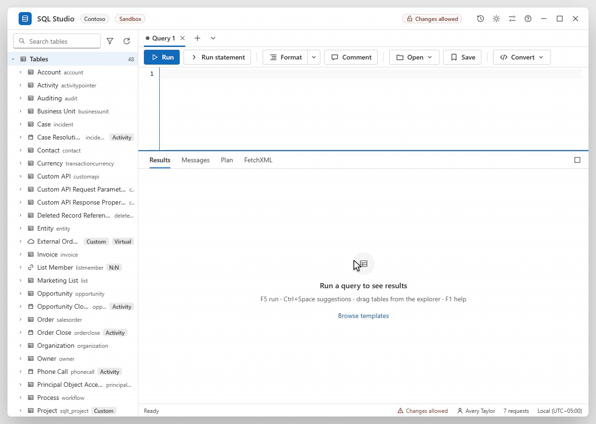

# SQL Studio

A Microsoft Edge bookmarklet for querying and changing Microsoft Dataverse / Dynamics 365 / Power Apps data with SQL,
right in your signed-in browser session. Nothing to install and no server: it runs in the page and talks only to that
environment's own Web API (`/api/data/v9.2/`).



The same demo as a [video (MP4)](docs/gallery/SQLStudio-demo.mp4).

**Install:** open [kevins.github.io](https://kevins.github.io/) and drag the **SQL Studio** button onto your favourites
bar (or open [`dist/install.html`](dist/install.html)). Then open any model-driven app page and click the favourite.

## What it does

- **T-SQL as SQL Server runs it:** joins, subqueries, CTEs (also recursive), window functions, GROUP BY / HAVING,
  UNION / INTERSECT / EXCEPT, PIVOT / UNPIVOT, FOR JSON and FOR XML, and a large function library, with SQL Server's
  NULL, collation and type rules.
- **Pushed to Dataverse where it can be:** queries become FetchXML (links, filters, aggregates, keyset paging); the rest
  runs in the browser. The plan and the FetchXML sent are one click away.
- **INSERT, UPDATE, DELETE and EXEC:** also through joins, CTEs and derived tables, with OUTPUT, lookups and choices.
  Every write first opens a preview of exactly the records and values it will change.
- **Scripts:** variables, IF / WHILE, TRY / CATCH, THROW / RAISERROR, `#temp` tables and table variables, cursors, GO,
  `sp_executesql`.
- **Tables beyond the data:** `metadata.*` and `sys.*` views of the schema, `archive.*` (long-term retention) and
  `bin.*` (recycle bin), and Dataverse functions as table-valued functions (`SELECT * FROM WhoAmI()`).
- **Results:** an editable grid, charts, export to CSV / Excel / JSON / XML, Copy as INSERT statements, Markdown or
  Web API URL, Open as view / Save as personal view, Import current view, FetchXML ⇄ SQL, Load CSV as `#temp`.
- **Undo** for inserts, updates and grid edits; **Execute as** another user; history, templates and Help.

## Safety

- A write sends only the requests its preview showed, to exactly those records, with their record versions (If-Match),
  after you confirm. The preview lists old → new values, cascaded deletes and the plug-ins and flows that will run.
- UPDATE and DELETE without a real filter are blocked unless you allow them in Settings; one statement changes at most
  5,000 records unless you raise the limit. A backup download before each DELETE can be turned on in Settings.
- The mode pill in the top bar switches SQL Studio to read-only and back.
- No transactions: Dataverse commits every write at once, so `BEGIN TRAN` / `ROLLBACK` are refused instead of pretending.

## Build

Requires Node.js 22 or later.

```bash
npm install
npm run build     # dist/sql-studio.bookmarklet.txt, dist/install.html
```

The bookmarklet must stay under Edge's 2,097,152-character favourite limit; `build.mjs` checks it.

## Credits

Inspired by [SQL 4 CDS](https://github.com/MarkMpn/Sql4Cds) by Mark Carrington. SQL Studio bundles no third-party
libraries.

Not affiliated with or endorsed by Microsoft. Dynamics 365, Dataverse and Power Apps are trademarks of Microsoft.

## License

[MIT](LICENSE)
